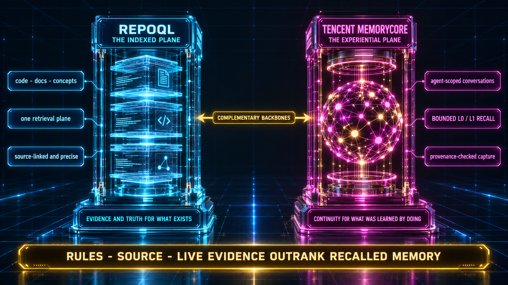

# Singularity-RepoQL

Singularity-RepoQL gives your coding agents memory and code intelligence that survive the session. Pick exactly one of the four installation options below and hand its brief, as written, to your AI agent.



Architecture illustration from the WikiJS Memory Architecture page.

## Choose exactly one installation option

1. **Option 1** — Claude Code + Tencent MemoryCore
2. **Option 2** — Claude Code Complete (+ Ghost, + Claude Office)
3. **Option 3** — existing OpenChamber + Tencent MemoryCore
4. **Option 4** — existing OpenChamber Complete (+ Ghost, + Claude Office)

## Option 1 — Claude Code + Tencent MemoryCore

```text
Install Singularity RepoQL — Option 1: Claude Code + Tencent MemoryCore.

Repository: https://github.com/ali3nz/Singularity-RepoQL

I already have Claude Code and RepoQL. Clone the repository, or update my existing clone, and follow the technical Option 1 instructions in its documentation. Before the first write, inspect my existing installation and show me what would change. Preserve my existing configuration, projects, agents, plugins, indexes, memories and credentials. Back up every conflicting Claude Code configuration file, and get my consent before any change.

Install and configure:
- Tencent MemoryCore with all seven specialist agents, each with its own scoped identity and its own persistent memory, plus the primary memory for my normal Claude Code sessions.
- Automatic capture of ordinary conversations, and automatic recall of them in a NEW session, without me running any manual remember command.
- Automatic extraction of conversations into memory.
- Automatic documentation assessment, automatic documentation updates and automatic verified ingestion of the approved documentation.
- Evaluation of knowledge candidates and their gated promotion into verified knowledge.
- The existing RepoQL MCP integration, so real RepoQL tool calls work.
- The native Claude Code lifecycle hooks and gates.
- Two working LLM API providers with a controlled failover between them.

This option does not install Ghost, Claude Office or OpenChamber.

When you finish, verify each capability with the repository's acceptance procedure and report the ACTUAL result of every check: the automatic capture, the NEW-session recall, the RepoQL tool calls, the documentation and knowledge workflows and the provider failover. If any mandatory capability is missing, report INCOMPLETE and say exactly what is missing. Never report success for a capability you did not verify.
```

## Option 2 — Claude Code Complete

```text
Install Singularity RepoQL — Option 2: Claude Code Complete.

Repository: https://github.com/ali3nz/Singularity-RepoQL

I already have Claude Code and RepoQL. Clone the repository, or update my existing clone, and follow the technical Option 2 instructions in its documentation. Before the first write, inspect my existing installation and show me what would change. Preserve my existing configuration, projects, agents, plugins, indexes, memories and credentials. Back up every conflicting Claude Code configuration file, and get my consent before any change.

Install and configure:
- Tencent MemoryCore with all seven specialist agents, each with its own scoped identity and its own persistent memory, plus the primary memory for my normal Claude Code sessions.
- Automatic capture of ordinary conversations, and automatic recall of them in a NEW session, without me running any manual remember command.
- Automatic extraction of conversations into memory.
- Automatic documentation assessment, automatic documentation updates and automatic verified ingestion of the approved documentation.
- Evaluation of knowledge candidates and their gated promotion into verified knowledge.
- The existing RepoQL MCP integration, so real RepoQL tool calls work.
- The native Claude Code lifecycle hooks and gates.
- Two working LLM API providers with a controlled failover between them.
- The Ghost persistent companion agent with its checkpointed dream workflow and interruption recovery, using the Claude Code backend.
- Claude Office, built from the public fork https://github.com/ali3nz/claude-office, showing native Claude Code events.

This option does not install or depend on OpenChamber.

When you finish, verify each capability with the repository's acceptance procedure and report the ACTUAL result of every check: the running Ghost, the completed dream cycle and its interruption recovery, the native Claude Office events, the automatic capture and NEW-session recall, the RepoQL tool calls, the documentation and knowledge workflows and the provider failover. If any mandatory capability is missing, report INCOMPLETE and say exactly what is missing. Never report success for a capability you did not verify.
```

## Option 3 — existing OpenChamber + Tencent MemoryCore

```text
Install Singularity RepoQL — Option 3: existing OpenChamber + Tencent MemoryCore.

Repository: https://github.com/ali3nz/Singularity-RepoQL

I already have OpenChamber and RepoQL. Clone the repository, or update my existing clone, and follow the technical Option 3 instructions in its documentation. Attach to my EXISTING OpenChamber installation. Do NOT install a second OpenChamber instance. Before the first write, inspect that installation and show me what would change. Preserve my existing configuration, projects, agents, plugins, indexes, memories, credentials and my RepoQL identity. Back up every conflicting configuration file, and get my consent before any change.

Install and configure:
- Tencent MemoryCore with all seven specialist agents, each with its own scoped identity and its own persistent memory, plus the primary memory for my primary OpenChamber session.
- Automatic capture of ordinary sessions, and automatic recall of them in a NEW session, without me running any manual remember command.
- Automatic extraction of conversations into memory.
- Automatic documentation assessment, automatic documentation updates and automatic verified ingestion of the approved documentation.
- Evaluation of knowledge candidates and their gated promotion into verified knowledge.
- The existing RepoQL MCP integration, so real RepoQL tool calls work in my sessions.
- The native OpenChamber hooks and gates.
- Two working LLM API providers with a controlled failover between them. Help me configure them.

This option does not install Ghost and does not install Claude Office.

When you finish, verify each capability with the repository's acceptance procedure and report the ACTUAL result of every check: the automatic capture, the NEW-session recall, the real RepoQL tool calls, the documentation and knowledge workflows and the provider failover. If any mandatory capability is missing, report INCOMPLETE and say exactly what is missing. Never report success for a capability you did not verify.
```

## Option 4 — existing OpenChamber Complete

```text
Install Singularity RepoQL — Option 4: existing OpenChamber Complete.

Repository: https://github.com/ali3nz/Singularity-RepoQL

I already have OpenChamber and RepoQL. Clone the repository, or update my existing clone, and follow the technical Option 4 instructions in its documentation. Attach to my EXISTING OpenChamber installation. Do NOT install a second OpenChamber instance. Before the first write, inspect that installation and show me what would change. Preserve my existing configuration, projects, agents, plugins, indexes, memories, credentials and my RepoQL identity. Back up every conflicting configuration file, and get my consent before any change.

Install and configure:
- Tencent MemoryCore with all seven specialist agents, each with its own scoped identity and its own persistent memory, plus the primary memory for my primary OpenChamber session.
- Automatic capture of ordinary sessions, and automatic recall of them in a NEW session, without me running any manual remember command.
- Automatic extraction of conversations into memory.
- Automatic documentation assessment, automatic documentation updates and automatic verified ingestion of the approved documentation.
- Evaluation of knowledge candidates and their gated promotion into verified knowledge.
- The existing RepoQL MCP integration, so real RepoQL tool calls work in my sessions.
- The native OpenChamber hooks and gates.
- Two working LLM API providers with a controlled failover between them.
- The Ghost persistent companion agent with its checkpointed dream workflow and interruption recovery, using the OpenChamber backend.
- Claude Office, built from the public fork https://github.com/ali3nz/claude-office, showing native OpenChamber activity.

Verify each capability with the repository's acceptance procedure and report the ACTUAL result of every check: the running Ghost, the completed dream cycle and its interruption recovery, the native Claude Office events, the automatic capture and NEW-session recall, the real RepoQL tool calls, the documentation and knowledge workflows and the provider failover. If any mandatory capability is missing, report INCOMPLETE and say exactly what is missing. Never report success for a capability you did not verify.
```

## What it does

- Persistent memory per agent identity: captured automatically from ordinary sessions and recalled automatically in a later session, with no manual remember command.
- Automatic extraction, documentation assessment, documentation updates and verified ingestion of the approved documentation.
- Gated evaluation and promotion of knowledge candidates into verified knowledge.
- RepoQL code intelligence wired into the client you already use.
- One diagnostic entrypoint — `node scripts/doctor.mjs` — reports every capability of your installation (VERIFIED / INCOMPLETE / DEGRADED / NOT_CONFIGURED / FAILED), machine-readable with `--json`, and exits nonzero while anything is unverified.

The installer reports INCOMPLETE until every mandatory capability of the chosen option is verified by a real check. Nothing is reported as working on configuration alone.

## Requirements

- Git, and access to `https://github.com/ali3nz/Singularity-RepoQL`.
- Docker, to run the Tencent MemoryCore stack.
- Claude Code (options 1 and 2) or an existing OpenChamber installation (options 3 and 4). Options 3 and 4 attach to that installation and never install a second one.
- RepoQL, already installed and reachable.
- Two LLM API provider accounts of your own, with keys you hold. Sign up directly with each provider; pricing, quotas and model availability are set by the provider:
  - NVIDIA — https://build.nvidia.com/
  - Groq — https://console.groq.com/     - Go sign up and get an API key, its free. The rest can be ignored for now. 
  - Cerebras — https://cloud.cerebras.ai/ - Go sign up and get an API key, its free. The rest can be ignored for now. 
  - OpenRouter — https://openrouter.ai/
  - Cohere — https://dashboard.cohere.com/
- The shipped extraction failover router supports Groq and Cohere out of the box (`secrets/groq-api-key`, `secrets/cohere-api-key`). Any additional OpenAI-compatible provider (NVIDIA, Cerebras, OpenRouter, …) can be onboarded with a PAIR in the secrets directory — `<name>-api-key` plus `<name>-api-provider.json` (`{ "name", "base" (https), "model" }`); a file that does not validate never becomes a hop. Verify both extraction providers and a controlled live fallback (`scripts/runtime-proofs.mjs`) before accepting failover.

## Technical documentation

Memory Core — `docs/MEMORY-SETUP.md` · Claude Code — `docs/CLAUDE-CODE-SETUP.md` ·
OpenChamber — `docs/OPENCHAMBER-SETUP.md` · Ghost — `docs/GHOST-SETUP.md` ·
Claude Office — `docs/OFFICE-SETUP.md` · RepoQL — `docs/REPOQL-SETUP.md` ·
documentation ingestion — `docs/DOC-INGESTION.md` ·
memory capture and promotion — `docs/memory-capture-promotion.md` ·
architecture — `docs/ARCHITECTURE.md` · troubleshooting — `docs/TROUBLESHOOTING.md`

## License

This repository is licensed under the MIT License (see `LICENSE`).
