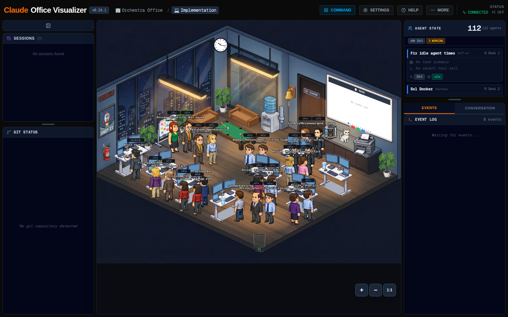

# Claude Office — activity visualizer (bundled into installation options 2 and 4)

Claude Office renders agent activity as a pixel-art office: every session is a
"boss", subagents are employees, and tool use, waits and completions animate
live. Singularity feeds it two ways:

- the OpenChamber plugin (`openchamber/plugins/product-office`) forwards
  session events over the product network, and
- [`../adapters/claude-code/`](../adapters/claude-code/) posts metadata-only
  events from Claude Code hooks (prompts and tool I/O are never forwarded).



*Live view of the reference deployment (v0.24.1, 2026-10-21): the office floor
with the agent cast, session and git panels on the left, and the live
agent-state and event panels on the right. The visualizer is a one-way,
read-only observer — nothing in it commands work.*

Office ships automatically with installation options 2 and 4; options 1 and 3 exclude it. Memory capture and recall work without it.

## Get the software

The reference deployment builds from the public fork
[`ali3nz/claude-office`](https://github.com/ali3nz/claude-office) — a fork of
[`paulrobello/claude-office`](https://github.com/paulrobello/claude-office)
(MIT) that carries the Focus/seating and idle-sweep updates used here.

```bash
git clone https://github.com/ali3nz/claude-office
cd claude-office
# optional: pin the validated revision
# git checkout 4ce0d00
docker build -t claude-office:local .
```

## Configure and run

1. Provision keys (from the repository root):

   ```bash
   python3 scripts/provision-secrets.py
   ```

   This writes `secrets/claude-office.env` (0600) with
   `CLAUDE_OFFICE_API_KEY` and `CLAUDE_OFFICE_INGEST_KEY`, and refreshes
   `data/opencode/config/product-secrets/office.json` for the plugin.

2. Start it (from the repository root):

   ```bash
   docker compose -f office/office.compose.yml up -d
   ```

The backend listens on `127.0.0.1:3128` (loopback only) and joins the product
network under the alias `product-office` — the name the plugin validates.
Open `http://127.0.0.1:3128`; the API key is delivered through the `?token=`
launch URL described in the upstream docs.

## Notes

- `CLAUDE_OFFICE_ALLOW_CIDR` (default `127.0.0.0/8,172.16.0.0/12`) restricts
  who may reach the ingest API. The product-network range must stay included
  for the plugin to deliver events.
- Event payloads carry whitelisted metadata only (session/tool names, statuses,
  project names). Prompts, assistant text and tool I/O are never forwarded.
- Data (SQLite) lives in `./data/office` — include it in your backup set.
- Rollback: tag the working image before upgrading
  (`docker tag claude-office:local claude-office:pre-upgrade`), then point
  `CLAUDE_OFFICE_IMAGE` at the old tag and re-run `docker compose up -d`.
- Fresh installations open on the bundled default arrangement (the reference
  deployment office); edits publish over it (newest wins).
